# CodonTraceSwarm

<p align="center">
  <a href="https://github.com/Parvaz-Jamei/CodonTraceSwarm"></a>
  <a href="https://en.cppreference.com/w/cpp/11"></a>
  <a href="https://github.com/Parvaz-Jamei/CodonTraceSwarm/blob/main/LICENSE"></a>
  <a href="https://github.com/Parvaz-Jamei/CodonTraceSwarm/releases"></a>
  
  
</p>

<p align="center">
  <strong>Deterministic, zero-heap telemetry codec and bidirectional command dispatch for Arduino and embedded C++11.</strong><br>
  Built specifically for edge sensor nodes connecting to the <a href="https://github.com/Parvaz-Jamei/codontrace-genesis">CodonTrace Genesis</a> digital-evolution & ALife research engine.
</p>

---

## 📑 Table of Contents

- [Overview](#-overview)
- [Why CodonTraceSwarm?](#-why-codontraceswarm)
- [Architecture & Data Flow](#-architecture--data-flow)
- [Core Features & Guarantees](#-core-features--guarantees)
- [Hardware Compatibility](#-hardware-compatibility)
- [Installation](#-installation)
- [Quick Start & Code Examples](#-quick-start--code-examples)
  - [1. Minimal Telemetry Producer](#1-minimal-telemetry-producer)
  - [2. Multi-axis Vectors & Waveforms](#2-multi-axis-vectors--waveforms)
  - [3. Safe Host Command Dispatcher](#3-safe-host-command-dispatcher)
  - [4. Hardened Sensor Integration (BME280)](#4-hardened-sensor-integration-bme280)
- [Protocol Wire Format (genesis_swarm_v2)](#-protocol-wire-format-genesis_swarm_v2)
- [Native Verification & Test Harness](#-native-verification--test-harness)
- [Phase Gates & Audit Status](#-phase-gates--audit-status)
- [Contributing & License](#-contributing--license)

---

## 🔭 Overview

**CodonTraceSwarm** is an embedded C++11 message serialization and dispatch engine conforming to the **Arduino 1.5 Library Specification**. It provides a hardened, deterministic communication layer between physical microcontroller nodes (ESP32, RP2040, ARM Cortex-M) and central research hosts.

Rather than treating sensor data as arbitrary floating-point numbers or raw unstructured JSON strings, CodonTraceSwarm enforces a rigorous schema contract: **typed channels** (scalar, vector, waveform, boolean, categorical), **explicit timestamping and clock uncertainty**, **bounded memory buffers**, and **cryptographically idempotent command sessions**.

---

## ⚡ Why CodonTraceSwarm?

Most IoT and Arduino libraries suffer from architectural pitfalls that corrupt empirical research and induce edge crashes:

| Common Embedded Pitfall | How CodonTraceSwarm Solves It |
|---|---|
| **Heap Fragmentation (`String` / `malloc`)** | **Zero dynamic allocation on hot paths.** Static 34 KiB footprint, fixed 8 KiB transmission buffers, and deterministic stack frames. |
| **Silent Float / Locale Corruption** | **Strict C-locale numeric serializer.** Guarantees period decimal formatting (`1.50`), strictly rejecting comma locales (`1,50`). |
| **Command Replay Attacks & Duplication** | **16-entry ring buffer & session nonces.** Commands are authenticated, scoped to boot nonces, and rejected if duplicate or expired. |
| **Phantom Data on Clock Drift** | **Monitored clock with stale-sample gating.** Explicit uncertainty tracking; stale or uncalibrated readings are flagged before transmission. |
| **Silent Sensor I2C Bus Hangs** | **Hardened checked readers.** Sensor wrappers check bus status on every register read rather than returning stale cached values. |

---

## 📐 Architecture & Data Flow

```mermaid
%%{init: {'theme':'base','themeVariables': {'primaryColor':'#e7eef8','primaryTextColor':'#142033','primaryBorderColor':'#1f4e79','lineColor':'#1f4e79','secondaryColor':'#f3efe6','tertiaryColor':'#f4e4dc','fontFamily':'ui-sans-serif, system-ui, sans-serif','fontSize':'14px'}}}%%
flowchart LR
  subgraph Node["Edge Microcontroller (ESP32 / RP2040 / Cortex-M)"]
    Sensors["Physical Sensors<br/>(BME280, SHT4x, INA219, etc.)"] --> Reader["Checked Bus Reader<br/>(CTS Sensor Wrappers)"]
    Reader --> Registry["Channel Registry<br/>(Up to 8 Typed Channels)"]
    Registry --> Codec["Device Codec<br/>(Zero-Heap Serializer)"]
    Clock["MonitoredClock<br/>(Age & Uncertainty Gate)"] --> Codec
    Codec --> Dispatcher["Command Dispatcher<br/>(16-Entry Dedup Ring)"]
    Dispatcher --> Reconnect["Reconnect Orchestrator<br/>(Bounded Backoff)"]
  end

  Reconnect <== "genesis_swarm_v2 (MQTT / TLS / Serial)" ==> Host["CodonTrace Genesis Host"]
  
  subgraph Engine["Host Research Suite"]
    Host --> Journal["Hash-Chained Journal<br/>(Tamper-Proof Audit)"]
    Journal --> Evolution["Digital Evolution Engine<br/>(Life-Loop ALife Simulation)"]
  end
```



---

## 🛡️ Core Features & Guarantees

### 1. Strongly Typed Channel Descriptors
Supports rich data types out of the box without string coercion:
- **`Scalar`**: Single floating-point values with optional range and frequency limits.
- **`Vector`**: Up to 16 named axes (e.g., Accelerometer/Gyro `x`, `y`, `z`).
- **`Waveform`**: Time-series arrays (up to 256 samples) for vibration or audio envelopes.
- **`Boolean`**: Exact digital states.
- **`Category`**: Discrete state labels with strict UTF-8 validation.

### 2. Zero Unbounded Allocations
The `cts::Device` object uses a fixed, predictable **34 KiB memory footprint**. Transmission buffers are bounded (`TxBytes = 8192`), eliminating runtime memory spikes and out-of-memory panics.

### 3. Bidirectional Command Engine
- Bounded 8-command FIFO queue with local callback dispatch.
- 16-entry history ring preventing duplicate executions upon network retries.
- Fine-grained permission model: nodes explicitly `allow()` operations (`sample`, `raw`, `features`, `result`, `set_rate`, `pipeline`, `capsule`) per channel.

### 4. Resilient Network Orchestration
- **`ReconnectOrchestrator`**: Enforces strict hello-before-reading handshakes, non-blocking backoff state machines, and in-flight message loss counters.
- **`ArduinoMqttAdapter`**: Optional modular adapter for standard MQTT loopback and TLS broker nodes.

### 5. Verified Sensor Library Glue
Pre-built, compile-tested wrappers for industry-standard sensors:
- **Bosch BME280** (Temperature, Pressure, Humidity via checked registers, bypassing buggy driver getters)
- **Sensirion SHT4x** (High-precision relative humidity and temperature)
- **TI INA219** (Voltage, Current, and Power monitoring)
- **ST VL53L0X** (Time-of-Flight distance sensing)
- **Bogde HX711** (Precision 24-bit ADC for load cells)
- **ProtoCentral FDC1004 & FDCxCapSense** (Capacitive liquid and proximity sensing)

---

## 🖥️ Hardware Compatibility

CodonTraceSwarm enforces a **strict $\ge$128 KB SRAM threshold** to ensure predictable buffer allocation without heap exhaustion:

| Architecture / Platform | Target SoC / Board | Status | Memory Profile |
|---|---|:---:|---|
| **Espressif ESP32** | ESP32-WROOM, S2, S3, C3, C6 | ✅ **Supported** | 320 KB – 512 KB SRAM |
| **Raspberry Pi RP2040** | Raspberry Pi Pico, Pico W | ✅ **Supported** | 264 KB SRAM |
| **ARM Cortex-M4 / M7** | Arduino Portenta H7, GIGA R1 WiFi | ✅ **Supported** | 512 KB – 1 MB SRAM |
| **Nordic nRF52840** | Arduino Nano 33 BLE, Nicla Sense | ✅ **Supported** | 256 KB SRAM |
| **Renesas RA6M5** | Arduino Portenta C33 | ✅ **Supported** | 512 KB SRAM |
| **AVR 8-bit** | Arduino Uno R3, Nano, Mega 2560 | ❌ **Excluded** | $\le$8 KB SRAM (Insufficient) |
| **Microchip SAMD21** | Arduino Zero, MKR Series | ❌ **Excluded** | 32 KB SRAM (Insufficient) |
| **Espressif ESP8266** | NodeMCU, ESP-01 | ❌ **Excluded** | $\le$80 KB SRAM (Insufficient) |

---

## 📦 Installation

### Method 1: Arduino IDE (ZIP or Git)
1. Clone or download this repository:
   ```bash
   git clone https://github.com/Parvaz-Jamei/CodonTraceSwarm.git
   ```
2. Move the `CodonTraceSwarm` directory into your Arduino libraries folder:
   - **Windows:** `Documents\Arduino\libraries\CodonTraceSwarm`
   - **Linux / macOS:** `~/Arduino/libraries/CodonTraceSwarm`
3. Restart the Arduino IDE. The library and examples will appear under `File -> Examples -> CodonTraceSwarm`.

### Method 2: PlatformIO
Add the repository directly to your `platformio.ini`:
```ini
[env:esp32dev]
platform = espressif32
board = esp32dev
framework = arduino
lib_deps =
    https://github.com/Parvaz-Jamei/CodonTraceSwarm.git#v0.12.9
```

---

## 🚀 Quick Start & Code Examples

### 1. Minimal Telemetry Producer

```cpp
#include <Arduino.h>
#include <CodonTraceSwarm.h>

// Allocate in global/static storage to avoid stack overflow (34 KiB footprint)
static cts::Device device;
static char wireBuffer[cts::TxBytes];

void setup() {
  Serial.begin(115200);

  // 1. Define a strongly-typed telemetry channel
  cts::ChannelSpec tempChannel;
  tempChannel.name = "ambient_temp";
  tempChannel.quantity = "temperature";
  tempChannel.unit = "degC";
  tempChannel.descriptor.type = cts::ValueType::Scalar;
  tempChannel.descriptor.featureId = "bme280_probe";
  tempChannel.descriptor.configId = "sensor_v1";
  tempChannel.descriptor.sourceUnit = "degC";

  if (device.define(tempChannel) != cts::Error::Ok) {
    Serial.println("Error defining channel!");
    return;
  }

  // 2. Initialize the session config
  cts::SessionConfig session;
  session.swarmId = "lab_station_01";
  session.nodeId = "esp32_node_alpha";
  session.bootId = "boot_20261014_001";
  session.wifi = true;

  if (device.begin(session) != cts::Error::Ok) {
    Serial.println("Error starting session!");
    return;
  }

  // 3. Emit the mandatory Hello handshake packet
  if (device.hello(wireBuffer, sizeof(wireBuffer)) == cts::Error::Ok) {
    Serial.println("=== HELLO PACKET ===");
    Serial.println(wireBuffer);
  }
}

void loop() {
  // 4. Sample and emit telemetry
  uint64_t simulatedUtcMs = 1791331500000ULL + millis();
  cts::Sample sample = cts::Sample::scalar(24.85, simulatedUtcMs);

  if (device.reading("ambient_temp", sample, wireBuffer, sizeof(wireBuffer)) == cts::Error::Ok) {
    Serial.println("=== READING PACKET ===");
    Serial.println(wireBuffer);
  }

  delay(5000);
}
```

---

### 2. Multi-axis Vectors & Waveforms

```cpp
#include <Arduino.h>
#include <CodonTraceSwarm.h>

static cts::Device device;
static char txBuffer[cts::TxBytes];

void setup() {
  Serial.begin(115200);

  // Define a 3D Vector channel (e.g. Accelerometer)
  cts::ChannelSpec imuChannel;
  imuChannel.name = "acceleration";
  imuChannel.quantity = "acceleration";
  imuChannel.unit = "m/s2";
  imuChannel.descriptor.type = cts::ValueType::Vector;
  imuChannel.descriptor.axes[0] = "x";
  imuChannel.descriptor.axes[1] = "y";
  imuChannel.descriptor.axes[2] = "z";
  imuChannel.descriptor.axisCount = 3;

  device.define(imuChannel);

  cts::SessionConfig session;
  session.swarmId = "field_test";
  session.nodeId = "imu_node";
  session.bootId = "boot_nonce_99";
  device.begin(session);
}

void loop() {
  cts::Sample sample;
  sample.valid = true;
  sample.status = "ok";
  sample.utcMs = 1791331600000ULL + millis();
  sample.values[0] = 0.02;  // x
  sample.values[1] = -0.15; // y
  sample.values[2] = 9.81;  // z
  sample.count = 3;

  if (device.reading("acceleration", sample, txBuffer, sizeof(txBuffer)) == cts::Error::Ok) {
    Serial.println(txBuffer);
  }
  delay(1000);
}
```

---

### 3. Safe Host Command Dispatcher

```cpp
#include <Arduino.h>
#include <CodonTraceSwarm.h>
#include <cts/Dispatcher.h>

static cts::Device device;
static cts::Dispatcher dispatcher;

// Idempotent command handler callback
cts::Error onCommandReceived(const char* channel, cts::Operation op, const char* paramsJson) {
  Serial.print("Executing command on channel: ");
  Serial.println(channel);
  // Execute local hardware task safely...
  return cts::Error::Ok;
}

void setup() {
  Serial.begin(115200);

  // Only allow explicitly granted operations
  device.allow("ambient_temp", cts::Operation::Sample);
  device.allow("ambient_temp", cts::Operation::SetRate);

  dispatcher.bind(&device);
  dispatcher.setHandler(onCommandReceived);
}
```

---

### 4. Hardened Sensor Integration (BME280)

```cpp
#include <Wire.h>
#include <Adafruit_BME280.h>
#include <CodonTraceSwarm.h>
#include <cts/sensors/Bme280Adafruit.h>

static cts::Device device;
static Adafruit_BME280 bme;
static const uint8_t kBmeAddress = 0x76;

void setup() {
  Serial.begin(115200);
  Wire.begin();

  if (!bme.begin(kBmeAddress)) {
    Serial.println("BME280 initialization failed!");
    while (1);
  }
  // Setup channels and begin session...
}

void loop() {
  // Checked read validates I2C bus status and uses 32-bit integer compensation
  cts::Bme280Checked reading = cts::bme280ReadChecked(Wire, kBmeAddress, millis());

  if (reading.temperature.valid) {
    Serial.print("Temperature: ");
    Serial.println(reading.temperature.value);
  }
  delay(2000);
}
```

---

## 📡 Protocol Wire Format (`genesis_swarm_v2`)

All packets adhere strictly to the JSON schema validated by the central `codontrace.swarm` Python coordinator:

#### Hello Handshake (`kind: "hello"`)
```json
{
  "schema": "genesis_swarm_v2",
  "swarm_id": "lab_station_01",
  "node_id": "esp32_node_alpha",
  "boot_id": "boot_20261014_001",
  "seq": 0,
  "kind": "hello",
  "payload": {
    "wifi": true,
    "channels": {
      "ambient_temp": {
        "quantity": "temperature",
        "unit": "degC",
        "descriptor": {
          "type": "scalar",
          "model": "direct",
          "feature_id": "bme280_probe",
          "config_id": "sensor_v1",
          "source_unit": "degC"
        }
      }
    },
    "operations": ["sample", "set_rate"]
  }
}
```

#### Vector Reading (`kind: "reading"`)
```json
{
  "schema": "genesis_swarm_v2",
  "swarm_id": "field_test",
  "node_id": "imu_node",
  "boot_id": "boot_nonce_99",
  "seq": 14,
  "kind": "reading",
  "payload": {
    "channel": "acceleration",
    "sample_ms": 1791331601000,
    "valid": true,
    "status": "ok",
    "values": [0.02, -0.15, 9.81],
    "count": 3
  }
}
```

---

## 🧪 Native Verification & Test Harness

CodonTraceSwarm features an exhaustive native test harness executable on host workstations without hardware attached:

```bash
# 1. Run all 17 native C++ contract test suites
python3 tools/check.py

# 2. Run with AddressSanitizer & UndefinedBehaviorSanitizer
python3 tools/check.py --sanitize

# 3. Verify against a pinned CodonTrace Genesis Python host
python3 tools/check.py --host /path/to/codontrace-genesis
```

Or using standard **CMake**:
```bash
cmake -S . -B build
cmake --build build
ctest --test-dir build --output-on-failure
```

---

## 🚦 Phase Gates & Audit Status

To preserve scientific rigor, all capabilities are subject to strict claim gating:

| Capability Subsystem | Current Status | Audit Verification |
|---|:---:|---|
| **C++11 Codec & JSON Serializer** | ✅ **VERIFIED** | Full native unit tests passing with AddressSanitizer. |
| **Command Deduplication & FIFO** | ✅ **VERIFIED** | Host-to-node roundtrip integration verified. |
| **Reconnect Orchestrator State Machine** | ✅ **VERIFIED** | Simulated loopback TLS MQTT crash/recovery tests. |
| **Checked Sensor Wrappers** | 🟡 **COMPILE-TESTED** | Compile-checked against vendor headers; bench qualification pending. |
| **Physical Hardware Bench Qualification** | ⏳ **IN-PROGRESS** | ESP32 physical Wi-Fi soak test running in lab campaign. |

---

## 👥 Contributing & License

Contributions are welcome! Please follow the strict C++11 subset guidelines, avoid dynamic allocations, and run `tools/check.py --sanitize` before opening a pull request.

- **Author & Maintainer:** [Parvaz Jamei](https://github.com/Parvaz-Jamei)
- **License:** Released under the permissive [MIT License](LICENSE).
