# CodonTraceSwarm

<p align="center">
  <a href="https://github.com/Parvaz-Jamei/CodonTraceSwarm/actions/workflows/arduino.yml"></a>
  <a href="https://github.com/Parvaz-Jamei/CodonTraceSwarm/actions/workflows/native.yml"></a>
  <a href="https://github.com/Parvaz-Jamei/CodonTraceSwarm"></a>
  <a href="https://en.cppreference.com/w/cpp/11"></a>
  <a href="https://github.com/Parvaz-Jamei/CodonTraceSwarm/blob/main/LICENSE"></a>
  <a href="https://github.com/Parvaz-Jamei/CodonTraceSwarm/releases"></a>
  
  <a href="#2-zero-unbounded-allocations"></a>
</p>

<p align="center">
  <strong>Deterministic, zero-heap telemetry codec and bidirectional command dispatch for Arduino and embedded C++11.</strong><br>
  Built specifically for edge sensor nodes connecting to the <a href="https://github.com/Parvaz-Jamei/codontrace-genesis">CodonTrace Genesis</a> digital-evolution & ALife research engine.
</p>

---

## 📑 Table of Contents

- [Overview](#-overview)
- [Why CodonTraceSwarm?](#-why-codontraceswarm)
- [Architecture & Data Flow](#-architecture--data-flow)
- [Core Features & Guarantees](#-core-features--guarantees)
- [Hardware Compatibility](#-hardware-compatibility)
- [Installation](#-installation)
- [Quick Start & Code Examples](#-quick-start--code-examples)
  - [1. Minimal Telemetry Producer](#1-minimal-telemetry-producer)
  - [2. Multi-axis Vectors & Waveforms](#2-multi-axis-vectors--waveforms)
  - [3. Safe Host Command Dispatcher](#3-safe-host-command-dispatcher)
  - [4. Hardened Sensor Integration (BME280)](#4-hardened-sensor-integration-bme280)
- [Protocol Wire Format (genesis_swarm_v2)](#-protocol-wire-format-genesis_swarm_v2)
- [Native Verification & Test Harness](#-native-verification--test-harness)
- [Phase Gates & Audit Status](#-phase-gates--audit-status)
- [Contributing & License](#-contributing--license)

---

## 🔭 Overview

**CodonTraceSwarm** is an embedded C++11 message serialization and dispatch engine conforming to the **Arduino 1.5 Library Specification**. It provides a hardened, deterministic communication layer between physical microcontroller nodes (ESP32, RP2040, ARM Cortex-M) and central research hosts.

Rather than treating sensor data as arbitrary floating-point numbers or raw unstructured JSON strings, CodonTraceSwarm enforces a schema contract: **typed channels** (scalar, vector, waveform, boolean, categorical), **explicit timestamp fields**, **bounded memory buffers**, and a **16-entry command history**. That history returns `HistoryFull` when it cannot admit another record. It does not silently drop a live record, and it is not cryptography. This library does not authenticate commands.

---

## ⚡ Why CodonTraceSwarm?

Most IoT and Arduino libraries suffer from architectural pitfalls that corrupt empirical research and induce edge crashes:

| Common Embedded Pitfall | How CodonTraceSwarm Solves It |
|---|---|
| **Heap Fragmentation (`String` / `malloc`)** | **Zero heap calls in CodonTraceSwarm code on the hot paths listed under "Zero Unbounded Allocations"** (tested; third-party sensor and MQTT libraries excluded). Static 34 KiB footprint, fixed 8 KiB transmission buffers, and deterministic stack frames. |
| **Silent Float / Locale Corruption** | **Strict C-locale numeric serializer.** Guarantees period decimal formatting (`1.50`), strictly rejecting comma locales (`1,50`). |
| **Duplicate command admission** | **16-entry history, not a drop ring.** `submit` returns `HistoryFull` when the history is full. Accepted records are not silently dropped. Dedup is not cryptographic, and this library does not authenticate commands. `DeliveryContext.authenticated` is an adapter assertion. |
| **Phantom Data on Clock Drift** | **Monitored clock with stale-sample gating.** Explicit uncertainty tracking; stale or uncalibrated readings are flagged before transmission. |
| **Silent Sensor I2C Bus Hangs** | **BME280 checked register reads.** That wrapper does not treat a finite Adafruit getter as success after a dead bus. Other wrappers call that sensor's own library. None of these sketches were flashed. |

---

## 📐 Architecture & Data Flow

```mermaid
%%{init: {'theme':'base','themeVariables': {'primaryColor':'#e7eef8','primaryTextColor':'#142033','primaryBorderColor':'#1f4e79','lineColor':'#1f4e79','secondaryColor':'#f3efe6','tertiaryColor':'#f4e4dc','fontFamily':'ui-sans-serif, system-ui, sans-serif','fontSize':'14px'}}}%%
flowchart LR
  subgraph Node["Edge microcontroller (not a support matrix)"]
    Sensors["Physical sensors<br/>(wrappers; not a bench result)"] --> Reader["Sensor wrappers<br/>(BME280 checked reads)"]
    Reader --> Registry["Channel registry<br/>(up to 8 typed channels)"]
    Registry --> Codec["Device codec<br/>(fixed buffers)"]
    Clock["Caller-supplied time<br/>(not millis as UTC)"] --> Codec
    Codec --> Dispatcher["Command dispatcher<br/>(16-entry history, HistoryFull)"]
    Dispatcher --> Reconnect["Reconnect orchestrator<br/>(no socket)"]
  end

  Reconnect <== "genesis_swarm_v2 bytes; this library does not open a socket" ==> Host["CodonTrace Genesis Host"]
  
  subgraph Engine["Host research suite (not implemented here)"]
    Host --> Journal["Host journal"]
    Journal --> Evolution["Digital evolution engine"]
  end
```



---

## 🛡️ Core Features & Guarantees

### 1. Strongly Typed Channel Descriptors
Supports rich data types out of the box without string coercion:
- **`Scalar`**: Single floating-point values with optional range and frequency limits.
- **`Vector`**: Up to 16 named axes (e.g., Accelerometer/Gyro `x`, `y`, `z`).
- **`Waveform`**: Time-series arrays (up to 256 samples) for vibration or audio envelopes.
- **`Boolean`**: Exact digital states.
- **`Category`**: Discrete state labels with strict UTF-8 validation.

### 2. Zero Unbounded Allocations
The `cts::Device` object uses a fixed, predictable **34 KiB memory footprint**. Transmission buffers are bounded (`TxBytes = 8192`), eliminating runtime memory spikes and out-of-memory panics.
**What "Heap Allocations Zero (Hot Path)" means, and how it is proven.** CodonTraceSwarm's own
code makes no heap call on these hot paths: `Device::hello`, `reading` (scalar, vector,
waveform, boolean, category, invalid), `heartbeat`; `CommandDecoder::decode`; `NetworkInbox`
push/poll; `CommandSession` submit/poll/reply confirm; `ArduinoMqttAdapter`
attach/receive/publishReply/close; and every `src/cts/sensors/*.h` adapter. Two checks back this:
- `pio test -e native_noheap` (`tests/pio/test_no_heap_{core,sensors,fdcx}`): the link uses
  `-Wl,--wrap=` for `malloc`, `calloc`, `realloc`, `free`, `aligned_alloc` and
  `posix_memalign`, and `tests/heap_counter.h` replaces every `operator new`/`delete` form
  (plain, array, nothrow, sized, `std::align_val_t` aligned). Each listed path runs inside a
  counting window and must record 0 allocations and 0 frees. A self-test proves each counter
  fires. Vendor APIs are test fakes (`tests/fakes`) and the MQTT client is a fixed-buffer fake.
- `tools/check_no_heap.py`: every `src/*.cpp` object, plus TUs in `tests/heap_symbols` that
  emit each header-only adapter (all sensor headers and an explicit `ArduinoMqttAdapter`
  instantiation), must reference no `malloc`, `calloc`, `realloc`, `posix_memalign`,
  `aligned_alloc`, `strdup`, `strndup` or `operator new`.

Not covered by the claim: setup calls (`define`, `begin`, `bind`), and third-party code. The
sensor libraries are outside it, and so is ArduinoMqttClient 0.1.8: at the reviewed SHA its
`messageTopic()` returns a `String` by value, it `reserve()`s the received topic, and
`beginMessage` copies the topic into a `String`, so a real ArduinoMqttClient can allocate
while the adapter runs. The adapter adds no allocation of its own.

### 3. Bidirectional Command Engine
- Bounded 8-command FIFO. `runOne` calls a `CommandExecutor`.
- 16-entry history. When it is full, `submit` returns `HistoryFull`. It is not a ring that silently drops records, and it is not cryptography.
- `Device::allow` records an application grant for a channel operation. It does not authenticate a command.

### 4. Resilient Network Orchestration
- **`ReconnectOrchestrator`**: Hello before reading, and loss accounting for a publish that fails or stalls. It does not open a socket. A Hello or Reading retry is bounded by `2 * attemptTimeoutMs` from the first attempt of that message. A pending command reply is not dropped by that budget. PUBACK is not Genesis application acceptance.
- **`ArduinoMqttAdapter`**: Optional synchronous MQTT 3.1.1 helper for ArduinoMqttClient (MQTT 5 is not implemented; see `docs/ARDUINO_MQTT_ADAPTER.md`). It is not the nonblocking reconnect seam. No broker round-trip is claimed done.

### 5. Sensor Library Glue
Wrappers call the sensor library named in the header (BME280 uses checked register reads instead of the Adafruit getters). They are compile-tested in CI for every FQBN in the table below (see `evidence/arduino_compile_matrix.json`). They were not flashed and not bench-tested.
- **Bosch BME280** (checked calibration and measurement bytes)
- **Sensirion SHT4x**
- **TI INA219**
- **ST VL53L0X**
- **Bogde HX711** (library scale unit, not a calibrated mass)
- **ProtoCentral FDC1004** and **FDCxCapSense** (separate headers; do not include both)

---

## 🖥️ Hardware Compatibility

`library.properties` lists architectures described as having at least 128 KB SRAM and excludes smaller parts. 128 KB is not a measured TLS budget, and this library does not measure or enforce runtime headroom.

| Target | How it is recorded | Status |
|---|---|---|
| **Arduino Nano 33 BLE** | FQBN `arduino:mbed_nano:nano33ble` (Linux, Windows, macOS hosts) | Compile-tested in CI. Not flashed. Not bench-tested. |
| **ESP32** | FQBN `esp32:esp32:esp32` (Espressif core 3.3.12) | Compile-tested in CI. Not flashed. Not bench-tested. |
| **Raspberry Pi Pico** | FQBNs `rp2040:rp2040:rpipico` (Earle Philhower core) and `arduino:mbed_rp2040:pico` | Compile-tested in CI. Not flashed. Not bench-tested. |
| **Portenta H7, GIGA R1, Opta, Portenta C33** | FQBNs `arduino:mbed_portenta:envie_m7`, `arduino:mbed_giga:giga`, `arduino:mbed_opta:opta`, `arduino:renesas_portenta:portenta_c33` | Compile-tested in CI. Not flashed. Not bench-tested. |
| **AVR, megaAVR, SAMD21, UNO R4, ESP8266, Due** | Excluded by `library.properties` | Not supported. |

---

## 📦 Installation

### Method 1: Arduino IDE (ZIP or Git)
1. Clone or download this repository:
   ```bash
   git clone https://github.com/Parvaz-Jamei/CodonTraceSwarm.git
   ```
2. Move the `CodonTraceSwarm` directory into your Arduino libraries folder:
   - **Windows:** `Documents\Arduino\libraries\CodonTraceSwarm`
   - **Linux / macOS:** `~/Arduino/libraries/CodonTraceSwarm`
3. Restart the Arduino IDE. The library and examples will appear under `File -> Examples -> CodonTraceSwarm`.

### Method 2: PlatformIO
Add the repository directly to your `platformio.ini`:
```ini
[env:esp32dev]
platform = espressif32
board = esp32dev
framework = arduino
lib_deps =
    https://github.com/Parvaz-Jamei/CodonTraceSwarm.git#0.12.11
```

The git tag is `0.12.11`, not `v0.12.11`. `library.json` is the PlatformIO manifest. CI compiles the examples for `esp32:esp32:esp32` with arduino-cli; the `esp32dev` PlatformIO environment above is not built in CI. Host-native PlatformIO + Unity tests run with `pio test -e native` (ASan/UBSan, see `platformio.ini`): one Unity suite per module under `tests/pio/` (codec, command decoder, command session, NetworkInbox bounds, ArduinoMqttAdapter framing with a fake client). The loopback contract job checks the C++ wire format against Genesis commit `a928ee4`.

---

## 🚀 Quick Start & Code Examples

### 1. Minimal Telemetry Producer

CoreSmoke is the sketch that prints a hello and a reading and does not open a socket.

```cpp
#include <Arduino.h>
#include <CodonTraceSwarm.h>

// Allocate in global/static storage to avoid stack overflow (34 KiB footprint)
static cts::Device device;
static char wireBuffer[cts::TxBytes];
static const uint64_t kSyntheticUtcMs = 1791331500000ULL;

void setup() {
  Serial.begin(115200);

  cts::ChannelSpec tempChannel;
  tempChannel.name = "ambient_temp";
  tempChannel.quantity = "temperature";
  tempChannel.unit = "degC";
  tempChannel.descriptor.type = cts::ValueType::Scalar;
  tempChannel.descriptor.featureId = "bme280_probe";
  tempChannel.descriptor.configId = "sensor_v1";
  tempChannel.descriptor.sourceUnit = "degC";

  if (device.define(tempChannel) != cts::Error::Ok) {
    Serial.println("Error defining channel!");
    return;
  }
  if (device.allow("ambient_temp", cts::Operation::Sample) != cts::Error::Ok ||
      device.allow("ambient_temp", cts::Operation::SetRate) != cts::Error::Ok) {
    Serial.println("Error granting operation!");
    return;
  }

  cts::SessionConfig session;
  session.swarmId = "lab_station_01";
  session.nodeId = "esp32_node_alpha";
  session.bootId = "boot_20261014_001";
  // begin() requires wifi true. This snippet does not open a socket.
  session.wifi = true;

  if (device.begin(session) != cts::Error::Ok) {
    Serial.println("Error starting session!");
    return;
  }

  if (device.hello(wireBuffer, sizeof(wireBuffer)) == cts::Error::Ok) {
    Serial.println("=== HELLO PACKET ===");
    Serial.println(wireBuffer);
  }
}

void loop() {
  cts::Sample sample = cts::Sample::scalar(24.85, kSyntheticUtcMs);

  if (device.reading("ambient_temp", sample, wireBuffer, sizeof(wireBuffer)) == cts::Error::Ok) {
    Serial.println("=== READING PACKET ===");
    Serial.println(wireBuffer);
  }

  delay(5000);
}
```

---

### 2. Multi-axis Vectors & Waveforms

This snippet encodes one vector reading and does not open a socket.

```cpp
#include <Arduino.h>
#include <CodonTraceSwarm.h>

static cts::Device device;
static char txBuffer[cts::TxBytes];
static const uint64_t kVectorUtcMs = 1791331601000ULL;

void setup() {
  Serial.begin(115200);

  cts::ChannelSpec imuChannel;
  imuChannel.name = "acceleration";
  imuChannel.quantity = "acceleration";
  imuChannel.unit = "m/s2";
  imuChannel.descriptor.type = cts::ValueType::Vector;
  imuChannel.descriptor.featureId = "imu_accel";
  imuChannel.descriptor.configId = "imu_v1";
  imuChannel.descriptor.sourceUnit = "m/s2";
  imuChannel.descriptor.axes[0] = "x";
  imuChannel.descriptor.axes[1] = "y";
  imuChannel.descriptor.axes[2] = "z";
  imuChannel.descriptor.axisCount = 3;

  if (device.define(imuChannel) != cts::Error::Ok) {
    Serial.println("Error defining channel!");
    return;
  }

  cts::SessionConfig session;
  session.swarmId = "field_test";
  session.nodeId = "imu_node";
  session.bootId = "boot_nonce_99";
  // begin() requires wifi true. This snippet does not open a socket.
  session.wifi = true;
  if (device.begin(session) != cts::Error::Ok) {
    Serial.println("Error starting session!");
    return;
  }
  if (device.hello(txBuffer, sizeof(txBuffer)) == cts::Error::Ok) {
    Serial.println(txBuffer);
  }
}

void loop() {
  cts::Sample sample;
  sample.valid = true;
  sample.status = "ok";
  sample.utcMs = kVectorUtcMs;
  sample.values[0] = 0.02;
  sample.values[1] = -0.15;
  sample.values[2] = 9.81;
  sample.count = 3;

  if (device.reading("acceleration", sample, txBuffer, sizeof(txBuffer)) == cts::Error::Ok) {
    Serial.println(txBuffer);
  }
  delay(1000);
}
```

---

### 3. Safe Host Command Dispatcher

This snippet runs one Dispatcher command and does not authenticate commands or open a socket.

```cpp
#include <Arduino.h>
#include <CodonTraceSwarm.h>
#include <cts/Dispatcher.h>
#include <cstring>

static const uint64_t kSyntheticUtcMs = 1791331500000ULL;

class SyntheticClock : public cts::ClockProvider {
 public:
  cts::ClockReading read() noexcept override {
    cts::ClockReading reading;
    reading.utcMs = kSyntheticUtcMs;
    reading.monotonicMs = 1000;
    reading.synchronized = true;
    return reading;
  }
};

class SyntheticPolicy : public cts::CommandPolicy {
 public:
  bool permits(const cts::Command &command) const noexcept override {
    return command.operation == cts::Operation::Sample &&
           std::strcmp(command.channel, "ambient_temp") == 0;
  }
};

class SyntheticExecutor : public cts::CommandExecutor {
 public:
  bool execute(const cts::Command &command) noexcept override {
    Serial.print("execute id=");
    Serial.println(command.id);
    return true;
  }
};

static cts::Device device;
static SyntheticClock clockProvider;
static SyntheticPolicy policy;
static SyntheticExecutor executor;
static cts::Dispatcher dispatcher(clockProvider, policy);

void setup() {
  Serial.begin(115200);

  cts::ChannelSpec channel;
  channel.name = "ambient_temp";
  channel.quantity = "temperature";
  channel.unit = "degC";
  channel.descriptor.featureId = "bme280_probe";
  channel.descriptor.configId = "sensor_v1";
  channel.descriptor.sourceUnit = "degC";
  if (device.define(channel) != cts::Error::Ok) {
    Serial.println("define failed");
    return;
  }
  if (device.allow("ambient_temp", cts::Operation::Sample) != cts::Error::Ok) {
    Serial.println("allow failed");
    return;
  }

  if (dispatcher.begin("lab_station_01", "esp32_node_alpha", "boot_20261014_001") !=
      cts::DispatchCode::Ok) {
    Serial.println("dispatcher begin failed");
    return;
  }

  static const char command[] =
      "{\"schema\":\"genesis_swarm_command_v1\",\"swarm_id\":\"lab_station_01\","
      "\"node_id\":\"esp32_node_alpha\",\"boot_id\":\"boot_20261014_001\","
      "\"command_id\":\"c1\",\"operation\":\"sample\","
      "\"params\":{\"channel\":\"ambient_temp\"},"
      "\"created_ms\":1791331500000,\"expires_ms\":1791331505000,"
      "\"status\":\"pending\"}";
  cts::DeliveryContext delivery;
  // Adapter assertion only. This library does not authenticate.
  delivery.authenticated = true;
  delivery.retained = false;
  const cts::DispatchResult submitted =
      dispatcher.submit(command, sizeof(command) - 1, delivery);
  const cts::DispatchResult ran = dispatcher.runOne(executor);
  Serial.print("submit=");
  Serial.println(submitted.code == cts::DispatchCode::Queued ? "Queued" : "not-queued");
  Serial.print("run=");
  Serial.println(ran.state == cts::CommandState::Succeeded ? "Succeeded" : "not-succeeded");
}

void loop() {}
```

---

### 4. Hardened Sensor Integration (BME280)

The sensor sketches print a local reading and do not open a codec session.

```cpp
#include <Wire.h>
#include <Adafruit_BME280.h>
#include <CodonTraceSwarm.h>
#include <cts/sensors/Bme280Adafruit.h>

static Adafruit_BME280 bme;
static const uint8_t kBmeAddress = 0x76;
static bool chipOpened = false;

static void printField(bool &first, const char *name, const cts::Sample &sample,
                       const char *unit) {
  if (!first)
    Serial.print(" | ");
  first = false;
  Serial.print(name);
  Serial.print('=');
  if (sample.valid) {
    Serial.print(sample.value);
    Serial.print(' ');
    Serial.print(unit);
  } else {
    Serial.print(sample.status);
  }
}

void setup() {
  Serial.begin(115200);
  Wire.begin();
  chipOpened = bme.begin(kBmeAddress);
}

void loop() {
  if (!chipOpened) {
    Serial.println("BME280 begin_failed");
    delay(2000);
    return;
  }
  cts::Bme280Checked reading = cts::bme280ReadChecked(Wire, kBmeAddress, 0);
  bool first = true;
  printField(first, "temperature", reading.temperature, "degC");
  printField(first, "pressure", reading.pressure, "Pa");
  printField(first, "humidity", reading.humidity, "%");
  Serial.println();
  delay(2000);
}
```

---

## 📡 Protocol Wire Format (`genesis_swarm_v2`)

These are the compact bytes produced by `device.hello` and `device.reading` for the snippets above, not a hand-written schema. The C++ field is `descriptor.type`. The encoder writes `value_type` and `measurement_model`. Vector samples are a JSON array in `value`, not `values` and not `count`. `"wifi":true` is emitted by the codec after `begin` accepts the session. The snippets do not open a socket. Numeric text is the encoder's `%.17g` formatting.

#### Hello from section 1 (`Device::hello`)
```json
{"schema":"genesis_swarm_v2","swarm_id":"lab_station_01","node_id":"esp32_node_alpha","boot_id":"boot_20261014_001","seq":0,"kind":"hello","payload":{"wifi":true,"channels":{"ambient_temp":{"quantity":"temperature","unit":"degC","descriptor":{"value_type":"scalar","measurement_model":"direct","feature_id":"bme280_probe","config_id":"sensor_v1","source_unit":"degC"}}},"operations":["sample","set_rate"]}}
```

#### Scalar reading from section 1 (`Device::reading`)
```json
{"schema":"genesis_swarm_v2","swarm_id":"lab_station_01","node_id":"esp32_node_alpha","boot_id":"boot_20261014_001","seq":1,"kind":"reading","payload":{"channel":"ambient_temp","sample_ms":1791331500000,"value":24.850000000000001,"processing_version":"cts-rebuild-01","valid":true,"status":"ok","config_id":"sensor_v1"}}
```

#### Vector hello from section 2 (`Device::hello`)
```json
{"schema":"genesis_swarm_v2","swarm_id":"field_test","node_id":"imu_node","boot_id":"boot_nonce_99","seq":0,"kind":"hello","payload":{"wifi":true,"channels":{"acceleration":{"quantity":"acceleration","unit":"m/s2","descriptor":{"value_type":"vector","measurement_model":"direct","feature_id":"imu_accel","config_id":"imu_v1","source_unit":"m/s2","axes":["x","y","z"]}}},"operations":[]}}
```

#### Vector reading from section 2 (`Device::reading`)
```json
{"schema":"genesis_swarm_v2","swarm_id":"field_test","node_id":"imu_node","boot_id":"boot_nonce_99","seq":1,"kind":"reading","payload":{"channel":"acceleration","sample_ms":1791331601000,"value":[0.02,-0.14999999999999999,9.8100000000000005],"processing_version":"cts-rebuild-01","valid":true,"status":"ok","config_id":"imu_v1"}}
```

---

## 🧪 Native Verification & Test Harness

Native tests run on a host workstation. They are not a broker round-trip and not N10.

```bash
# 1. Run the native C++ contract tests
python3 tools/check.py

# 2. Run with AddressSanitizer & UndefinedBehaviorSanitizer
python3 tools/check.py --sanitize

# 3. Optional pinned CodonTrace Genesis checkout. This is not N06's broker round-trip, and N10 is not done.
python3 tools/check.py --host /path/to/codontrace-genesis
```

Or using standard **CMake**:
```bash
cmake -S . -B build
cmake --build build
ctest --test-dir build --output-on-failure
```

---

## 🚦 Phase Gates & Audit Status

| Capability | Status | What that status means |
|---|---|---|
| **C++11 codec and JSON** | Native tests | `tools/check.py` on the host. Not a board soak. |
| **Command history and FIFO** | Native tests | 16-entry history returns `HistoryFull` when full. Not a broker round-trip. This library does not authenticate commands. |
| **Reconnect orchestrator** | Native tests | Synthetic publisher and connect client. Not a TLS MQTT crash test. |
| **Sensor wrappers** | Compile-tested in CI | Every FQBN in `evidence/arduino_compile_matrix.json`. Not flashed. Not bench-tested. |
| **Other `library.properties` architectures** | Compile-tested in CI | One FQBN each (`evidence/arduino_compile_matrix.json`). Not flashed. Not bench-tested. |
| **N06 broker round-trip** | Not done | Sensor sketches do not deliver a host journal entry. |
| **N10 reply recovery against lost Genesis state** | Not done | PUBACK is not Genesis application acceptance. |

---

## 👥 Contributing & License

Contributions are welcome! Please follow the strict C++11 subset guidelines, avoid dynamic allocations, and run `tools/check.py --sanitize` before opening a pull request.

- **Author & Maintainer:** [Parvaz Jamei](https://github.com/Parvaz-Jamei)
- **License:** Released under the permissive [MIT License](LICENSE).
